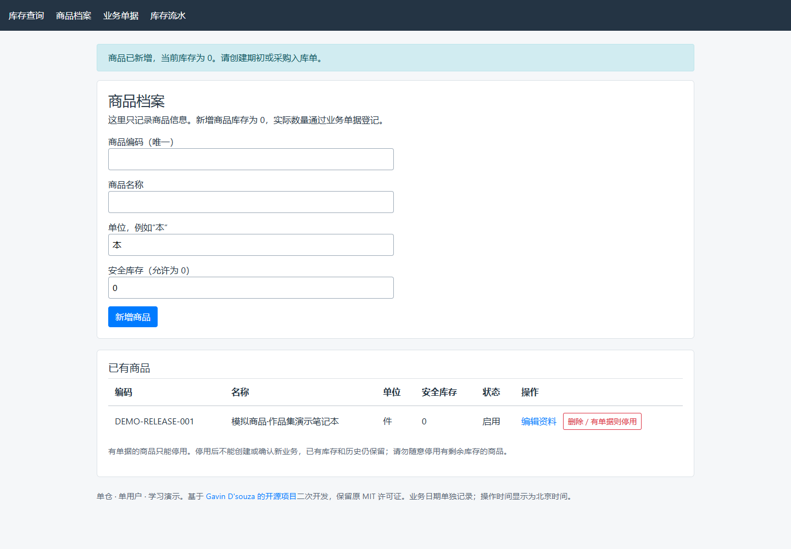
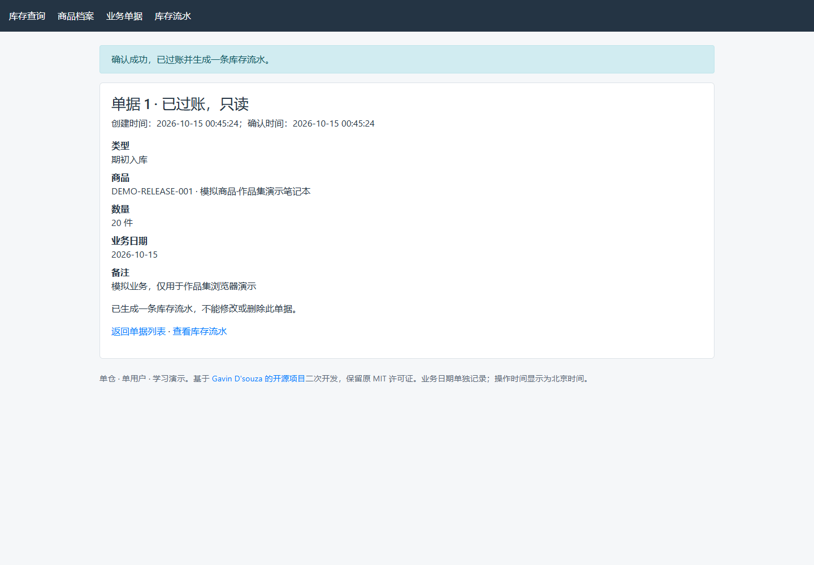
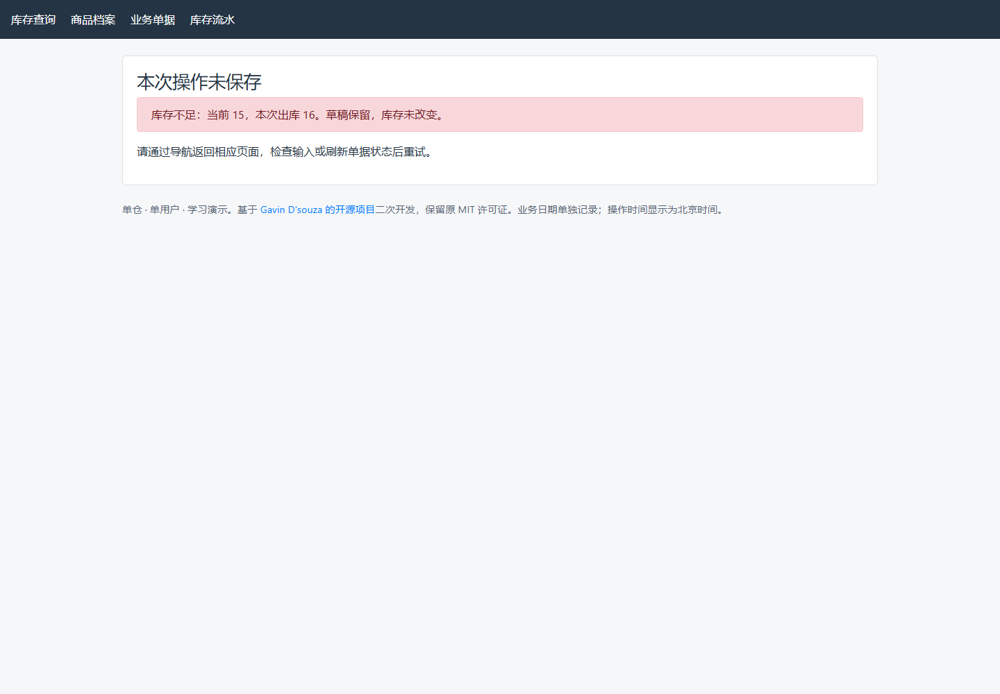
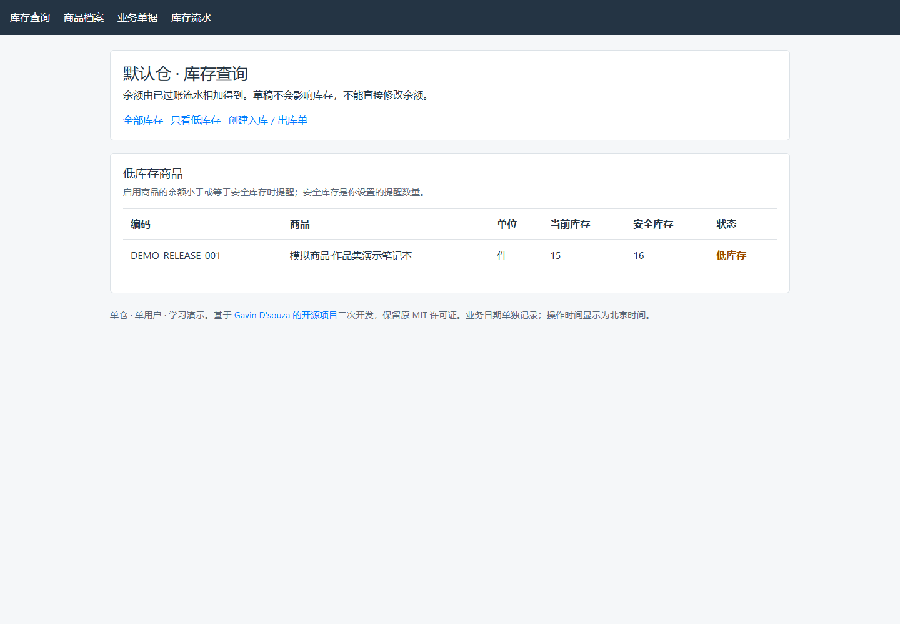
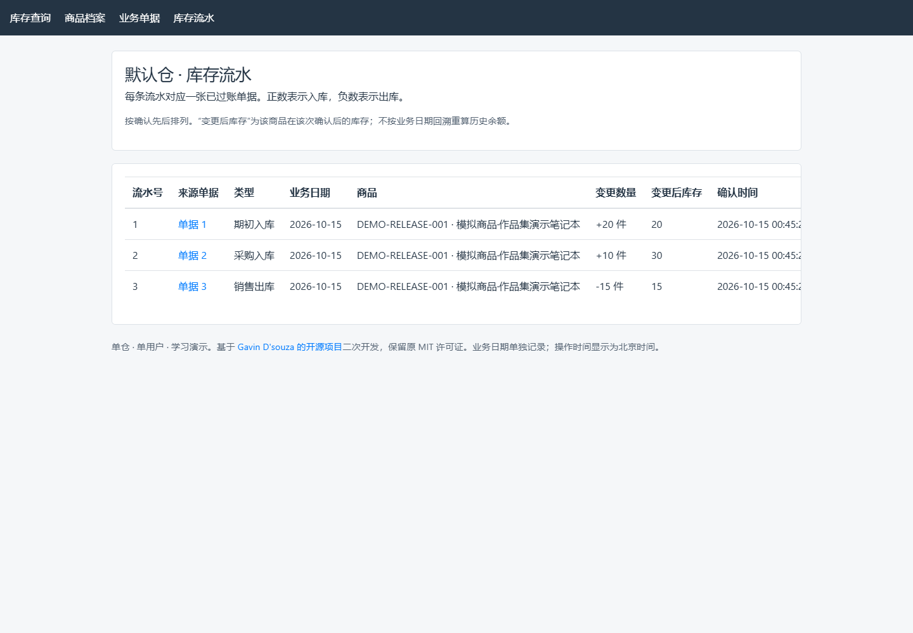

# 轻量级进销存管理系统 · 求职学习作品

> **干净公开快照（源码发布版）**：本目录是原工作区之外的完整可运行源码副本，不继承上游Git对象及完整历史，不含数据库、虚拟环境和旧图标/GIF。原作者MIT许可证与来源保留。最新验证见 [验证摘要](docs/public-snapshot-validation.json)。
>
> 本项目基于 Gavin D'souza 的开源库存管理项目学习和二次开发，使用人工智能（AI）辅助增加单仓期初、采购、销售、草稿与过账、库存流水、超售校验和低库存提醒。个人实际参与主要包括需求与范围确定、流程规则梳理、辅助开发中的反馈，以及核心功能操作验收；不声称全部代码、上游功能或自动测试脚本由本人独立手写。仅用于应届生求职展示，不是真实企业上线系统。


基于 [Gavin D'souza 的 inventory-management-system](https://github.com/gavindsouza/inventory-management-system) 二次开发，使用人工智能辅助实现。用于学习采购、销售和库存核对，展示需求梳理、业务规则设计和功能验收能力。当前是**本机运行、单仓、单用户、每张单据一个商品**的数量管理系统，没有正式上线或企业应用经历。

原作者版权：**Copyright (c) 2018 Gavin D'souza**。保留完整 [MIT 许可证](LICENSE)、[原版说明](README_UPSTREAM.md)及第三方声明，不将二次开发描述为完全原创。

## 真实浏览器演示截图

以下8张图片于2026-10-15使用 Playwright 驱动真实 Chrome 浏览器，在独立临时 SQLite 库中通过网页表单操作后直接截图。商品明确标注为模拟数据，没有人工合成页面、生成式图片或直接填写库存余额，也不替代本人手工验收。

本轮截图场景为：期初20件、采购10件、销售15件，结存15件；超售16被拒绝。先以安全库存0验证余额，再通过真实编辑表单设置为16，展示 **15 < 16** 的提醒；这与演示指南中阈值15的等值场景是两个独立案例。详见 [截图自动化证据](docs/portfolio-release-evidence.json)。

### 商品档案



<details>
<summary>查看期初20、采购10、销售15的已过账单据截图</summary>




</details>

### 结存15件


### 超售拦截



### 低库存提醒



### 已过账库存流水



截图保留原页面布局，流水表较宽，确认时间列需横向滚动；没有为美化截图修改业务页面。截图仅含模拟信息，不包含浏览器账户、本机文件路径或表单凭据。

## 技术栈

| 技术 | 本项目中的用途 |
|---|---|
| Python | 编写业务处理逻辑；配置声明 >=3.10，审查环境为 3.12.14 |
| Flask | 接收网页请求、校验表单并处理单据；已验证版本 3.1.3 |
| Jinja2 | 把服务器数据填入网页模板；已验证版本 3.1.6 |
| SQLite | 将商品、单据、流水保存到本地文件；通过 Python 标准库访问 |
| Bootstrap | 本地页面样式，版本 4.1.3，不依赖在线样式服务 |

新版页面没有独立前端构建步骤。正常业务运行不调用付费或外部业务接口；安装依赖需要联网。原页面保留的 jQuery 脚本不参与新版业务计算。

## 已实现的核心功能

- 商品档案：唯一编码和名称、单位、安全库存；有单据后只能停用，不能删除；已有单据时编码和单位固定。
- 期初入库：登记开始使用系统时已有的数量，每个商品最多确认一次，且先于其他已过账业务。
- 采购入库、销售出库：保存或修改草稿，核对后确认；每张单据一个商品，无价格金额。
- 数量与资料校验：数量必须为正整数；拒绝无效商品、停用商品、无效日期等输入；安全库存允许为 0。
- 超售拦截：确认销售时检查当时库存，不足则保留草稿，不扣库、不生成流水。
- 库存查询与低库存提醒：启用商品的余额小于或等于安全库存时提醒。
- 库存流水：关联来源单据，记录正负变更与确认后的余额；已过账单据及流水只读。
- 基础保护：同单不重复过账、事务内检查和写入、跨站请求伪造防护、连接关闭、删除通过明确提交执行。

“过账”表示正式确认业务并生成库存流水。“事务”表示一组数据库变更一起成功或一起撤销。跨站请求伪造防护用于拒绝缺少合法表单凭据的修改请求，不等于登录权限控制。

## 本地安装与启动

### Windows PowerShell

准备 Python 3.12（本次验证版本系列），下载或克隆本仓库后进入含 `pyproject.toml` 的目录。以下命令使用项目内 `.venv`，它是项目独立的 Python 依赖环境：

```powershell
python --version
python -m venv .venv
& ./.venv/Scripts/python.exe -m pip install -r requirements-tested.txt
& ./.venv/Scripts/python.exe -m pip install --no-deps -e .
& ./.venv/Scripts/python.exe -m flask --app inventory.app run --host 127.0.0.1 --port 5000
```

Windows若出现 `WinError 206`（路径过长），可将项目放在较短目录（例如 `C:/projects/inventory-portfolio-public`），或为当前安装进程设置较短的临时目录。本轮初次安装曾遇到此问题，缩短临时目录后独立安装成功，没有修改业务逻辑或系统安全策略。

如果 `python` 不可用，先检查 Python 安装及命令路径，不要通过关闭系统安全设置解决。命令直接使用环境中的 Python，不要求激活脚本或管理员权限。`-e .` 表示将当前源码安装为可编辑项目，`--no-deps` 表示不重复解析已按文件安装的依赖。

浏览器访问 [http://127.0.0.1:5000](http://127.0.0.1:5000)。保持服务窗口运行；按 Ctrl+C 停止。重启只执行最后一条命令，不要删除数据库。这个地址仅用于本机，不是可分享给其他电脑的在线演示网址。

首次启动自动建立默认 `portfolio.sqlite`。后续使用同一文件，已保存数据会保留。安装依赖联网；本机业务操作无需外部服务。本公开副本不带环境目录；读者按上述标准步骤在本副本中自行建立 `.venv`，不要依赖原学习项目的环境路径。

### 可选配置

| 环境变量 | 用途 |
|---|---|
| `DATABASE_NAME` | 指定数据库文件的完整路径；目录必须已存在且可写 |
| `INVENTORY_SECRET_KEY` | 会话签名密钥，应通过本地环境配置，不写入仓库 |
| `FLASK_DEBUG` | 调试开关；演示建议为 `0` |

应用不会自动读取 `.env` 文件；若选择这种文件保存本地配置，需要自己加载，且不得提交其中真实凭据。没有固定签名密钥时，重启后会生成新密钥，旧表单可能失效，刷新后重新填写即可，不影响业务文件中的数据。

准备演示或测试副本时，使用 [演示指南](docs/demo-guide.md)中的独立数据库方法，不覆盖当前学习数据。

## 核心业务流程与库存规则

1. 新建商品档案，库存为 0。
2. 保存入库或出库草稿，不生成流水、不占用库存。
3. 确认时读取最新单据及库存，检查商品、数量、单据状态和可用量。
4. 在同一事务内更新单据状态、生成一条流水；任一步失败则撤销本次变更。
5. 根据已过账流水计算余额；同一单据重复确认不再生成流水。

```text
商品档案 → 保存草稿（库存不变）→ 核对并确认 → 已过账单据 + 库存流水
                                                    ↓
                                              查询余额与提醒
```

在当前不含退货、损坏等业务的范围内：

```text
当前库存 = 已过账期初数量 + 已过账采购数量 − 已过账销售数量
示例：期初 20 + 采购 10 − 销售 15 = 结存 15
```

期初与采购流水记正数，销售记负数。确认时库存不足则拒绝；不能通过商品资料直接修改余额。流水按确认顺序展示每次余额；业务日期可以补填，但不据此回溯重算历史可用库存。操作时间显示北京时间。

## 测试方式与已经验证的结果

从仓库根目录执行。以下写法同时隔离导入应用时的建表和各个测试文件，不触碰默认学习数据库：

```powershell
New-Item -ItemType Directory -Force .local-tests | Out-Null
$previousDatabase = $env:DATABASE_NAME
$previousDebug = $env:FLASK_DEBUG
try {
    $env:DATABASE_NAME = Join-Path (Resolve-Path .local-tests).Path 'import-only.sqlite'
    $env:FLASK_DEBUG = '0'
    & ./.venv/Scripts/python.exe -m pytest -q -p no:cacheprovider
} finally {
    $env:DATABASE_NAME = $previousDatabase
    $env:FLASK_DEBUG = $previousDebug
}
```

截至 **2026-10-14** 的交付审查，实际结果为 **73 项通过、0 失败、0 错误、0 跳过，耗时 6.70 秒**：

| 测试文件 | 覆盖范围 | 检查数 |
|---|---|---:|
| `tests/test_integrations.py` | 原 6 个业务断言，运行修复后的原应用 `inventory.legacy` | 6 |
| `tests/test_regressions.py` | 第一轮缺陷回归，运行原应用 | 29 |
| `tests/test_business_flow.py` | 新版单据、库存、事务、重复确认、同时出库、新进程读取等 | 38 |

另外用隔离服务器实际验证了三种业务、超售、非法数量、严格低于阈值、五次进出后的余额核对，以及重复读取网页后记录不变。完整证据见 [验证摘要](docs/public-snapshot-validation.json)与 [发布副本独立验证摘要](docs/public-snapshot-validation.json)。73 项不是 73 种新版业务，也不是本人独立编写或亲手执行的 73 项测试。上述为此前审查结果；本公开快照本轮独立安装和测试结果见根目录准备报告，不能混同两个批次。

此前交付材料整理（2026-10-15）未重新运行业务测试，引用的是上述有证据的审查结果。个人手工验收请另填 [验收表](docs/manual-acceptance.md)，其中实际结果与通过状态预留为空；自动测试不会代替个人操作记录。

## 当前限制

- 只管理数量；没有价格金额、成本、利润、收付款、税费或会计凭证，不能称为财务记账系统。
- 新版为单仓、单用户，每单一个商品；没有供应商/客户档案、多仓调拨、多人权限、复杂报表或支付。
- 没有登录、访客隔离、草稿删除、停用后重新启用、退货、冲销或反审核。
- 没有公开部署；开发服务器只供本机学习。匿名公网写入、持久存储、备份恢复等条件尚未具备。
- 未完整验证新电脑安装、各操作系统、浏览器及屏幕兼容性、大规模负载与长期运行。
- 旧调拨数据不自动迁移到新业务库。单据确认保护不能替代访问控制。

## 目录与交付文档

```text
inventory/                  新版入口 app.py、原流程 legacy.py、模板与静态资源
  templates/mvp/            新版页面
  static/                   本地样式、原脚本和图标
 tests/                     原功能测试、缺陷回归、新业务测试
 docs/
  public-snapshot-validation.json 发布副本独立验证摘要（不含原始日志）
  demo-guide.md              约两分钟演示脚本与模拟库准备
  manual-acceptance.md       待本人填写的手工验收表
  upstream-and-contributions.md 原功能、改造和贡献归属
  third-party-notices.md     已保留版权及已排除素材说明
  licenses/                 Bootstrap、jQuery官方许可证全文
 README_UPSTREAM.md          原说明
 LICENSE                     原 MIT 许可证
 pyproject.toml              项目、构建及依赖配置
 requirements-tested.txt     审查环境依赖版本，不含本机源码路径
```

## 开源来源与人工智能辅助开发

原仓库：[gavindsouza/inventory-management-system](https://github.com/gavindsouza/inventory-management-system)，基线提交 `d29d07109bc56b46c55e6d035e1cd5a53aaed123`。原项目已有商品数量、仓库、库存分配、调拨历史及基础测试。

本次改造沿用技术栈与本地样式，另行建立单据、状态与库存流水；原流程保留在 `inventory/legacy.py`。详细对照见 [来源与贡献说明](docs/upstream-and-contributions.md)。

代码、测试和文档使用人工智能辅助生成或调整。个人参与的业务范围确定、规则理解、手工验收应按实际记录说明；不宣称所有代码均独立手写，不虚构企业落地、上线或效率指标。本仓库以干净快照建立独立提交，不继承上游完整历史，不以原作者历史作为个人开发时间线。

许可证：[MIT](LICENSE)。原作者版权声明完整保留；第三方库声明见 [第三方声明](docs/third-party-notices.md)。授权未确认的旧图标和旧GIF已排除，原历史没有复制；本仓库保留 [验证摘要](docs/public-snapshot-validation.json)，相关记录描述独立快照验证时的结果，不代表公网部署状态。
